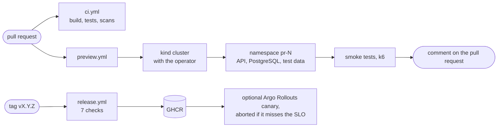
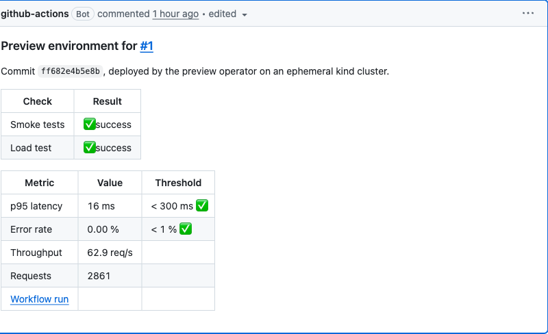

# dotnet-preview-platform

<a href="README.md"></a>
<a href="README.en.md"></a>

[](https://github.com/remi-maigrot/dotnet-preview-platform/actions/workflows/ci.yml)
[](build/README.md)
[](LICENSE)

For each pull request, CI starts a Kubernetes cluster and an operator written in C# creates a namespace for it,
with the API, a PostgreSQL instance and test data. Smoke and load tests run against that environment and the
results are posted on the pull request. On a laptop the same operator gives each preview its own URL and deletes
it when its time to live runs out.

The repository also has a CLI that sets all of this up locally, a release workflow with seven checks (not run
yet, see the limits below), and the dashboards and alert rules that go with the API.

The application is deliberately unexciting. It's an API for absence requests: an employee asks for leave, their
manager approves or rejects it. It's small, but it has real business rules, a schema that needs migrations, and
personal data.

## Running it locally

You need Docker, the .NET 10 SDK, k3d, kubectl and helm. `devctl doctor` tells you what's missing.

```sh
git clone https://github.com/remi-maigrot/dotnet-preview-platform && cd dotnet-preview-platform
dotnet run --project src/Devctl.Cli -- up
dotnet run --project src/Devctl.Cli -- preview create --pr 42
```

`up` creates a k3d cluster and a local registry, builds the images from your working copy, and installs Traefik,
the monitoring stack, the operator and the API. It takes about three minutes from scratch. This is a second run,
on a cluster that already existed:

```text
✓ Image tag (afb0e6976d14-dirty-1793192054, 0s)
✓ Cluster (already exists, 1s)
✓ Images (5 images pushed, 34s)
✓ Ingress (traefik ready, 1s)
✓ Observability (prometheus, grafana, tempo, loki, 24s)
✓ Operator (preview-operator running, 10s)
✓ API (Ready, 43s)
╭──────────┬────────────────────────────────────────────────────────────╮
│ What     │ Where                                                      │
├──────────┼────────────────────────────────────────────────────────────┤
│ API      │ http://local.preview.localtest.me:8080/v1/absence-requests │
│ OpenAPI  │ http://local.preview.localtest.me:8080/openapi/v1.json     │
│ Grafana  │ http://grafana.preview.localtest.me:8080                   │
│ Previews │ devctl preview create --pr <number>                        │
╰──────────┴────────────────────────────────────────────────────────────╯
```

`preview create --pr 42` then does what CI does for a pull request. After 20 or 30 seconds,
`http://pr-42.preview.localtest.me:8080` answers. `devctl down` removes everything. If you'd rather have `devctl`
on your `PATH`, the install steps are in [src/Devctl.Cli](src/Devctl.Cli/README.md).

Grafana opens on the API dashboard:


## What happens to a pull request



`ci.yml` checks the code. `preview.yml` builds the images, starts a kind cluster inside the job, installs the
operator, applies a `PreviewEnvironment` and waits for it to be ready. Then it runs the tests against it and
updates a single comment on the pull request:



Both workflows install their tools and call the Cake build in `build/`, the same targets you run locally (`dotnet
run --project build -- --target CI`), so most failures reproduce on a laptop.
[docs/architecture.md](docs/architecture.md) goes through the whole path, from pull request to release.

## What's in it

The operator (`src/Preview.Operator`) turns a `PreviewEnvironment` into a namespace with Pod Security set to
`restricted`, a quota, network policies that deny everything by default, generated credentials, a PostgreSQL
instance, a Helm release of the API and its test data. When the TTL runs out, or when someone deletes the
resource, a finalizer deletes the namespace. It runs as two replicas with leader election. The reconciler is
tested against a fake cluster, so most of its tests run in milliseconds.
[ADR 0001](docs/adr/0001-csharp-operator-instead-of-helm-alone.md)
 explains why this isn't just a Helm chart.

`devctl` (`src/Devctl.Cli`) handles `up`, `down`, `status`, `logs` and the `preview` commands. Every command can
print JSON and has documented exit codes. `preview diagnose` collects what you would otherwise dig out of
`kubectl describe` and the pod logs. Here it is on a preview I broke on purpose by giving it an image tag that
doesn't exist:

```text
$ devctl preview diagnose --pr 13
...
## Findings

- **Error: The image of sample-api-migrate-5ht6n/migrate cannot be pulled.** Back-off pulling image
  "preview-registry.localhost:5050/sample-migrator:does-not-exist": ErrImagePull: ... not found
  Check that this tag exists in the registry and that the cluster can reach it (devctl up pushes local builds).
...
```

The API never got as far as pulling its image. The migration job runs first, and that's the one stuck. The
command can also hand the report to an LLM endpoint you configure. Nothing is sent unless you configure one.
Passwords, tokens and email addresses are masked by pattern matching first, which is best effort, so
`--show-payload` prints exactly what would be sent.

The build (`build/`) is a [Cake Frosting](build/README.md) project: format check, build, tests with a coverage
threshold, Helm lint, image builds, Trivy, SBOMs, the backup round-trip test and packaging.

Releases start from a tag. `release.yml` runs seven checks in order. The tests run again on the tagged commit,
then the architecture rules, then the migrations, applied on top of the previous release's schema and data. The
images are scanned for critical CVEs on both architectures, get SBOMs, and are signed with cosign along with
their provenance. The final check is a smoke and load test on a real preview. Only then does the version tag go
on the image digests that were tested. The chart also has an optional canary rollout with Argo Rollouts, which
checks the error rate and latency against the SLO every 30 seconds.
[docs/release-qualification.md](docs/release-qualification.md) has the details.

I wanted proof that the rollback actually works, so the `Canary` workflow deploys a release that fails half of
its requests and checks that it gets aborted, then a healthy one that has to be promoted. This is what that run
looks like in Grafana:


The purple lines are the releases. Errors spike when the bad canary takes traffic and drop back to zero once the
analysis aborts it.

Configuration is typed and validated when the app starts. A missing connection string, a JWT key that's too short
or fault injection switched on in Production stops the pod with a message that names the setting, instead of
failing on the first request. Secrets are read from mounted files, not environment variables. The Helm values
have a JSON schema too. Every setting is listed in [docs/configuration.md](docs/configuration.md).

Monitoring is plain OpenTelemetry, sent to Prometheus, Tempo and Loki through a collector, with Grafana on top.
All of it is a single chart in `deploy/observability`. The dashboards and alert rules are files in the
repository, and the alert rules have unit tests that `promtool` runs in CI. The SLO alerts use multi-window burn
rates, and the latency panels carry exemplars, so you can jump from a slow bucket to a sample trace.

The data in the API is personal, so previews only get synthetic data, or a pseudonymised copy of a real database.
Free-text comments are erased 180 days after the request is decided. Backups are encrypted with age, and a job
restores one every day and checks it. [docs/data-protection.md](docs/data-protection.md) covers that. On the
security side, images are chiseled and run as non-root, and pods only get a service account token when they call
the API server. Cluster-wide, the operator can manage PreviewEnvironments and namespaces and bind two named
ClusterRoles; everything else is granted by a RoleBinding inside each preview namespace. Images are signed
keyless through GitHub's OIDC token, so there is no signing key to store. That's in
[docs/security.md](docs/security.md).

## Trade-offs

An operator is more code than a chart, about 700 lines of C# plus RBAC that someone has to review. I went with it
because Helm alone can't expire an environment, clean up after a failed install, keep credentials stable across
upgrades or report a status that CI can wait on.

One namespace per preview means one PostgreSQL per preview. That's fine for a handful of pull requests. With a
few dozen open at once I'd move to a shared server with a database per preview.

Migrations run in a Helm pre-upgrade Job and never when the app starts, so replicas don't race each other and the
API's database role can't change the schema. The cost is that every migration has to work with the previous
version of the app still running, which means splitting some changes over two releases.

Self-hosting Prometheus, Tempo and Loki costs about 2.5 GB of memory on a laptop. Because the code only speaks
OTLP, moving to a hosted backend later wouldn't touch the application, only the collector's exporters and the
Grafana datasources.

The reasoning behind each of these, and the options I turned down, is in the [ADRs](docs/adr).

## Known limits

- The clusters in CI are throwaway kind clusters created inside the job, so a preview only lives as long as its
  job. That's enough to test the operator, the chart and the images for real. It says nothing about a real
  network, storage class or node sizes. On a real platform the same operator would run on a shared cluster,
  previews would live out their TTL, and pull requests would only create and delete the resource.
- No release has been tagged yet. CI, previews, CodeQL and the canary test all run on GitHub, but the release
  workflow, and with it signing and publishing to GHCR, will only run for the first time on the first tag.
- The cluster doesn't refuse unsigned images. A policy controller would be the next step.
- Backups go to a volume in the same cluster. For real data they belong in object storage in another account,
  with object lock. Since they are daily `pg_dump`s, a restore can lose up to a day.
- The load test is small (10 virtual users for a minute). It catches an N+1 query, not a capacity problem.
- Traffic inside the cluster is restricted by network policies but not encrypted.

Each page in [docs](docs) ends with its own list of limits.

## Layout

```text
src/
  Sample.*                  the absence API: domain, application, infrastructure, API, migrator
  Preview.Operator/         the operator
  Preview.Operator.Crds/    PreviewEnvironment types, shared with devctl
  Preview.DataSeeder/       synthetic data, or a pseudonymised copy of a database
  Devctl.Cli/               devctl
tests/                      unit, integration (Testcontainers), architecture, operator, CLI, smoke
build/                      the Cake pipeline
deploy/
  helm/sample-api/          the API chart, with the canary and backup options
  operator/  crds/          the operator's manifests and the CRD
  observability/            the monitoring chart, dashboards, alert rules and their tests
  backup/                   backup image and its end-to-end test
  canary/  ci/              canary test, kind and Traefik settings for CI
load/                       k6 scripts
docs/                       architecture, ADRs, runbooks
```

There are also pages on the [API](docs/api.md), [observability](docs/observability.md), [runbooks](docs/runbooks)
for when something breaks, and [CONTRIBUTING.md](CONTRIBUTING.md) for building and testing.

## License

[MIT](LICENSE)
