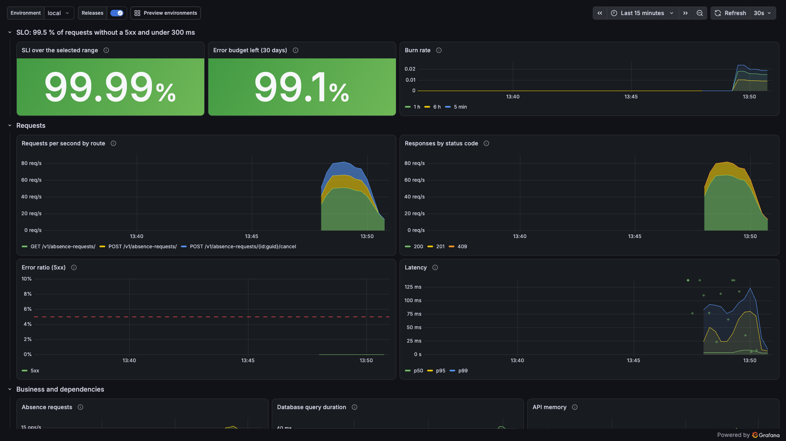
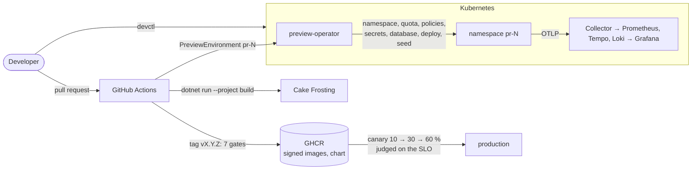
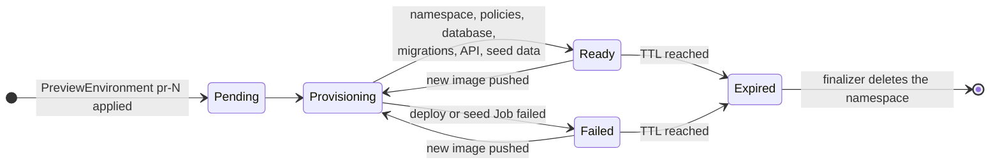
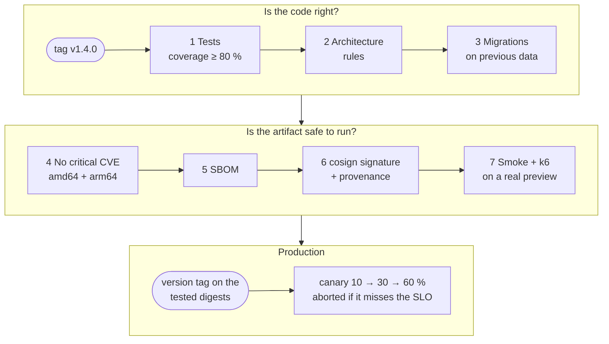
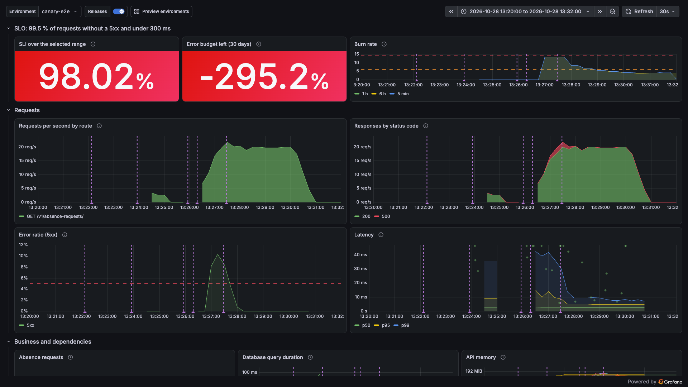

# dotnet-preview-platform

[](https://github.com/remi-maigrot/dotnet-preview-platform/actions/workflows/ci.yml)
[](build/README.md)
[](LICENSE)


A small internal developer platform for .NET 10 services on Kubernetes. Every pull request gets its own
isolated environment, created by an operator written in C#, seeded with data, tested, and deleted when its
TTL expires. Releases go through seven gates, then a canary that rolls itself back when it misses the SLO.

The service it runs is a deliberately ordinary one: an absence request API (employees ask for leave,
managers decide), there so the platform has a real application to build, migrate, test and release.



| | |
|---|---|
| Local platform from nothing | `devctl up`, about 3 minutes |
| A preview environment | Ready in 20 to 30 seconds, deleted after its TTL |
| Release gates | 7, from tests to load tests on a real preview |
| Tests | 292: unit, integration on real PostgreSQL, architecture, operator, CLI |
| Line coverage | 100 % domain, 98.6 % application (the build fails under 80 %) |
| Build warnings | 0, warnings are errors |

## Try it

You need Docker, the .NET 10 SDK, `k3d`, `kubectl` and `helm`.

```sh
git clone https://github.com/remi-maigrot/dotnet-preview-platform && cd dotnet-preview-platform
dotnet run --project src/Devctl.Cli -- up
dotnet run --project src/Devctl.Cli -- preview create --pr 42
```

The first command creates a local k3d cluster with its registry, builds the images from your working copy,
and installs Traefik, the observability stack, the operator and the API. On a laptop it takes about three
minutes from nothing, two when the cluster already exists:

```text
✓ Image tag (afb0e6976d14-dirty-1793192054, 0s)
✓ Cluster (already exists, 1s)
✓ Images (5 images pushed, 34s)
✓ Ingress (traefik ready, 1s)
✓ Observability (prometheus, grafana, tempo, loki, 24s)
✓ Operator (preview-operator running, 10s)
✓ API (Ready, 43s)
╭──────────┬────────────────────────────────────────────────────────────╮
│ What     │ Where                                                      │
├──────────┼────────────────────────────────────────────────────────────┤
│ API      │ http://local.preview.localtest.me:8080/v1/absence-requests │
│ OpenAPI  │ http://local.preview.localtest.me:8080/openapi/v1.json     │
│ Grafana  │ http://grafana.preview.localtest.me:8080                   │
│ Previews │ devctl preview create --pr <number>                        │
╰──────────┴────────────────────────────────────────────────────────────╯
```

The second one asks the operator for the environment of pull request 42, exactly as CI does, and waits
until it answers on `http://pr-42.preview.localtest.me:8080` (20 to 30 seconds). `devctl doctor` checks
the prerequisites, `devctl down` deletes everything. To get `devctl` on your `PATH`, see
[src/Devctl.Cli](src/Devctl.Cli/README.md).

## How it fits together



A pull request triggers two workflows. `ci.yml` checks the code: format, build, tests, coverage, Helm lint,
scan, SBOM. `preview.yml` builds the images, applies a `PreviewEnvironment`, runs the smoke and k6 tests
against it, and posts the results as a single comment on the pull request. Both only call the Cake build,
so whatever fails in CI fails the same way on your machine. The longer walkthrough, with a sequence diagram
from pull request to production, is in [docs/architecture.md](docs/architecture.md).

### The life of a preview



Closing the pull request deletes the resource at any point, and the same finalizer cleans up.

### The road to a release



## What this project demonstrates

**A developer CLI.** `devctl` (System.CommandLine, Spectre.Console) wraps k3d, Helm and the Kubernetes API:
`up`, `down`, `status`, `logs`, `preview create|list|delete|diagnose`. Every command has `--output json` and
documented exit codes, so scripts can rely on it. `preview diagnose` explains a broken preview: failing pods,
events, missing images, recent failed requests from Tempo. It can also pass the report to any
OpenAI-compatible endpoint you configure. Nothing is sent unless you set one, and secrets and emails are
redacted first. Here it is on a preview deployed with an image tag that doesn't exist:

```text
$ devctl preview diagnose --pr 13
# Preview pr-13

- Phase: Provisioning
- Image: preview-registry.localhost:5050/sample-api:does-not-exist

## Findings

- **Error: The image of sample-api-migrate-5ht6n/migrate cannot be pulled.** Back-off pulling image
  "preview-registry.localhost:5050/sample-migrator:does-not-exist": ErrImagePull: ... not found
  Check that this tag exists in the registry and that the cluster can reach it (devctl up pushes local builds).

## Conditions

- NamespaceReady=True Applied Namespace pr-13 and its policies are in place.
- DatabaseReady=True Running PostgreSQL accepts connections.
- ApplicationDeployed=False InProgress Deploying preview-registry.localhost:5050/sample-api:does-not-exist (job deploy-0dc8f9970d).
- Ready=False Provisioning The environment is being provisioned.

## Pods

- sample-api-migrate-5ht6n: Pending
  - migrate: ImagePullBackOff, 0 restart(s)
...
```

The API image was not the one that failed. The migrator runs first, and its missing image is what blocks the
preview.

**A Kubernetes operator in C#.** A cluster-scoped `PreviewEnvironment` resource becomes a namespace with Pod
Security `restricted`, a quota, deny-by-default network policies, generated credentials, a PostgreSQL
instance, a Helm deployment and seed data. It expires after its TTL, and a finalizer cleans up. Work queue
with per-key backoff, leader election across two replicas, idempotent steps. The reconciler is tested
without a cluster. [ADR 0001](docs/adr/0001-csharp-operator-instead-of-helm-alone.md) explains why this
isn't just a Helm chart.

**Pipelines in C#.** Every CI step is a [Cake Frosting](build/README.md) task. GitHub Actions installs tools,
calls `dotnet run --project build -- --target CI`, and does nothing else that could drift. Actions are
pinned by SHA and checked by actionlint and zizmor.

**Release qualification.** A tag only proposes a release. [release.yml](docs/release-qualification.md)
runs seven gates in order: tests and coverage, architecture rules, migrations on top of the previous
release's data, critical CVEs on both architectures, SBOMs, cosign signatures with provenance, then smoke and
load tests on a real preview. The version tag goes on the tested digests at the very end. In production the
chart can roll out with Argo Rollouts, analysed against the SLO every 30 seconds. The `Canary` workflow
proves both outcomes: a release that fails half of its requests is aborted, and a healthy one is promoted.

**Configuration that fails early.** Typed options validated at startup (data annotations, cross-field rules,
environment-specific rules such as "fault injection is refused in Production"), secrets read from mounted
files, and a JSON schema on the Helm values. A wrong setting stops the pod with a readable message instead
of failing on the first request. [docs/configuration.md](docs/configuration.md) lists every setting.

**Observability as code.** OpenTelemetry everywhere, without vendor exporters. The collector, Prometheus,
Tempo, Loki and Grafana are one versioned chart. Dashboards and alert rules live in the repository, and
alert rules have unit tests run by `promtool` in CI. Alerts on the SLO follow the multi-window burn-rate
method, exemplars link a latency spike to its trace, and each release leaves a marker on the dashboards.



*The canary test seen from Grafana. The purple lines are releases. The second release fails half of its
requests: the analysis aborts it, traffic goes back to the stable version and errors drop to zero. The third
release is healthy and promoted.*

### Across all six

- **Personal data.** Previews hold synthetic or pseudonymised data, never real data. Free text expires after
  180 days and requests after 5 years. Backups are encrypted with age and restored every day by a job that
  checks row counts and integrity. Telemetry carries no personal fields.
  [docs/data-protection.md](docs/data-protection.md)
- **Security.** Chiseled non-root images with a read-only filesystem, no service account token where none is
  needed, scoped RBAC, a database role per purpose, keyless signing, no long-lived CI credentials.
  [docs/security.md](docs/security.md)

## Repository layout

```text
src/
  Sample.Domain/            absence requests and their rules, no dependencies
  Sample.Application/       use cases
  Sample.Infrastructure/    EF Core, PostgreSQL, data retention
  Sample.Api/               Minimal API: auth, rate limiting, problem details, OpenTelemetry
  Sample.Api.Contracts/     request and response types shared with the tests
  Sample.Migrator/          applies migrations from a Helm pre-upgrade Job
  Preview.DataSeeder/       synthetic data, or a pseudonymised copy of a database
  Preview.Operator/         the operator
  Preview.Operator.Crds/    PreviewEnvironment types, shared by the operator and devctl
  Devctl.Cli/               devctl
tests/                      unit, integration (Testcontainers), architecture, operator, CLI, smoke
build/                      Cake Frosting: every CI and release step
deploy/
  crds/  operator/          the CRD and the operator's manifests
  helm/sample-api/          the API chart: probes, HPA, PDB, policies, canary, backups
  observability/            collector, Prometheus, Tempo, Loki, Grafana, dashboards, rules and their tests
  backup/                   backup image and its end-to-end test
  canary/  ci/              canary end-to-end test, kind and Traefik settings for CI
load/                       k6 scripts
.github/workflows/          ci, preview, release, canary, cleanup, codeql
docs/                       architecture, ADRs, runbooks, one page per concern
```

## Technical choices and trade-offs

Each of these has an ADR in [docs/adr](docs/adr) with the alternatives that were turned down.

- **An operator, not only a chart.** Helm describes one release well. It doesn't handle expiry, cleanup
  after a failure, credentials created once and kept, or a status CI can wait on. The cost is about 700
  lines of C# to maintain, and an RBAC footprint that has to be reviewed.
- **A namespace per preview.** Isolation comes from Kubernetes itself (quota, policies, Pod Security), and
  deleting a preview means deleting a namespace. It costs a PostgreSQL per preview, which is fine at this
  size and would call for a shared server with a database per preview past a few dozen.
- **Migrations in a Job, never at startup.** Several replicas starting at once don't race each other, the API
  runs with a role that can't change the schema, and a failed migration stops the release before any pod
  rolls.
- **Pipelines in C# rather than YAML.** The pipeline is compiled, debuggable and reproducible locally. In
  exchange, a contributor has to read C# to change CI, and the first build takes a few seconds longer.
- **OpenTelemetry only.** Switching to a hosted backend means changing the collector's exporters, not the
  code. Self-hosting Prometheus, Tempo and Loki costs memory on a laptop: about 2.5 GB for the stack.
- **Argo Rollouts for canaries.** Its analysis queries Prometheus directly and aborts on its own. It is one
  more controller in the cluster, and the chart keeps a plain Deployment when it's disabled.

## Known limits

- **CI clusters are ephemeral.** The preview and release workflows create a kind cluster inside the job, and
  the preview lives as long as the job. That proves the operator, the chart and the images, but not a real
  network, storage class or node size. On a real platform the same operator runs on a shared cluster,
  previews live for their TTL, and pull requests only apply and delete the resource.
- **The workflows have only been run locally so far.** They pass actionlint and zizmor, and every step they
  run is a Cake task that passes on my machine. Anything that only exists on GitHub (OIDC signing, GHCR,
  the release itself, the badges branch) will be proven by the first runs there.
- **No admission control on signatures.** Images are signed, but the cluster doesn't yet refuse unsigned
  ones. A policy controller is the next step.
- **Backups stay in the cluster.** They go to a persistent volume. A real setup writes them to object storage
  in another account, with object lock. Restores lose up to a day, since `pg_dump` is a daily logical backup.
- **The load test is small.** 10 virtual users for a minute catch an N+1 query or a missing index, not a
  capacity problem.
- **No mutual TLS inside the cluster.** Traffic is restricted by network policies, not encrypted.

More detail in the "Known limits" section of each page in [docs](docs).

## Documentation

| | |
|---|---|
| [Architecture](docs/architecture.md) | Components, pull request to production, reconciliation model |
| [API](docs/api.md) | Endpoints, states, idempotency, error codes |
| [Configuration](docs/configuration.md) | Every setting, its default and its validation |
| [Release qualification](docs/release-qualification.md) | The seven gates and the canary |
| [Observability](docs/observability.md) | SLO, dashboards, alerts |
| [Data protection](docs/data-protection.md) | Personal data, retention, backups |
| [Security](docs/security.md) | Supply chain, cluster, application |
| [Decisions](docs/adr) | Ten ADRs |
| [Runbooks](docs/runbooks) | Preview stuck, operator crashlooping, release rejected, failed migration, SLO burn, restore |
| [Contributing](CONTRIBUTING.md) | Build, test, conventions |

## License

[MIT](LICENSE)
