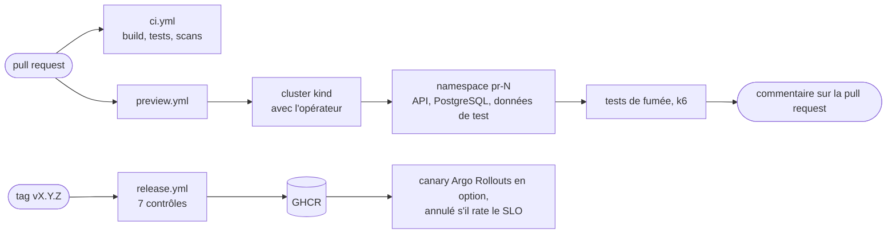

# dotnet-preview-platform

<a href="README.md"></a>
<a href="README.en.md"></a>

[](https://github.com/remi-maigrot/dotnet-preview-platform/actions/workflows/ci.yml)
[](build/README.md)
[](LICENSE)

À chaque pull request, la CI démarre un cluster Kubernetes, et un opérateur écrit en C# y crée un namespace avec
l'API, une base PostgreSQL et des données de test. Des tests de fumée et de charge tournent sur cet environnement,
et les résultats sont postés sur la pull request. En local, le même opérateur donne à chaque preview sa propre URL
et la supprime quand sa durée de vie est écoulée.

Le dépôt contient aussi une CLI qui monte tout ça sur un poste de dev, un workflow de release en sept contrôles
(jamais lancé pour l'instant, voir les limites plus bas), et les dashboards et règles d'alerte qui vont avec l'API.

L'application est volontairement banale : une API de demandes d'absence, où un salarié demande un congé et son
manager l'accepte ou le refuse. Elle est petite, mais elle a de vraies règles métier, un schéma qui demande des
migrations, et des données personnelles.

## Lancer en local

Il faut Docker, le SDK .NET 10, k3d, kubectl et helm. `devctl doctor` dit ce qui manque.

```sh
git clone https://github.com/remi-maigrot/dotnet-preview-platform && cd dotnet-preview-platform
dotnet run --project src/Devctl.Cli -- up
dotnet run --project src/Devctl.Cli -- preview create --pr 42
```

`up` crée un cluster k3d et un registre local, construit les images depuis la copie de travail, puis installe
Traefik, la stack de monitoring, l'opérateur et l'API. Compter environ trois minutes en partant de zéro. Voici un
second lancement, sur un cluster qui existait déjà :

```text
✓ Image tag (afb0e6976d14-dirty-1793192054, 0s)
✓ Cluster (already exists, 1s)
✓ Images (5 images pushed, 34s)
✓ Ingress (traefik ready, 1s)
✓ Observability (prometheus, grafana, tempo, loki, 24s)
✓ Operator (preview-operator running, 10s)
✓ API (Ready, 43s)
╭──────────┬────────────────────────────────────────────────────────────╮
│ What     │ Where                                                      │
├──────────┼────────────────────────────────────────────────────────────┤
│ API      │ http://local.preview.localtest.me:8080/v1/absence-requests │
│ OpenAPI  │ http://local.preview.localtest.me:8080/openapi/v1.json     │
│ Grafana  │ http://grafana.preview.localtest.me:8080                   │
│ Previews │ devctl preview create --pr <number>                        │
╰──────────┴────────────────────────────────────────────────────────────╯
```

`preview create --pr 42` fait ensuite ce que la CI fait pour une pull request. Au bout de 20 à 30 secondes,
`http://pr-42.preview.localtest.me:8080` répond. `devctl down` supprime tout. Pour avoir `devctl` dans le `PATH`,
l'installation est décrite dans [src/Devctl.Cli](src/Devctl.Cli/README.md).

Grafana s'ouvre sur le dashboard de l'API :


## Le parcours d'une pull request



`ci.yml` vérifie le code. `preview.yml` construit les images, démarre un cluster kind dans le job, installe
l'opérateur, applique une `PreviewEnvironment` et attend qu'elle soit prête. Il lance ensuite les tests et met à
jour un commentaire unique sur la pull request :


Les deux workflows se contentent d'installer leurs outils et d'appeler le build Cake de `build/`, avec les mêmes
cibles qu'en local (`dotnet run --project build -- --target CI`). La plupart des échecs de CI se reproduisent donc
sur un poste. [docs/architecture.md](docs/architecture.md) décrit tout le chemin, de la pull request à la release.

## Ce qu'il y a dedans

L'opérateur (`src/Preview.Operator`) transforme une `PreviewEnvironment` en namespace avec la Pod Security en
`restricted`, un quota, des network policies qui refusent tout par défaut, des identifiants générés, une instance
PostgreSQL, une release Helm de l'API et ses données de test. Quand la durée de vie est écoulée, ou quand quelqu'un
supprime la ressource, un finalizer supprime le namespace. Il tourne en deux réplicas avec élection de leader. Le
reconciler est testé contre un faux cluster, donc la plupart de ses tests prennent quelques millisecondes.
L'[ADR 0001](docs/adr/0001-csharp-operator-instead-of-helm-alone.md) explique pourquoi ce n'est pas un simple chart
Helm.

`devctl` (`src/Devctl.Cli`) gère `up`, `down`, `status`, `logs` et les commandes `preview`. Chaque commande peut
sortir du JSON et a des codes de retour documentés. `preview diagnose` rassemble ce qu'on irait sinon chercher à la
main dans `kubectl describe` et les logs des pods. Le voici sur une preview cassée exprès, avec un tag d'image qui
n'existe pas :

```text
$ devctl preview diagnose --pr 13
...
## Findings

- **Error: The image of sample-api-migrate-5ht6n/migrate cannot be pulled.** Back-off pulling image
  "preview-registry.localhost:5050/sample-migrator:does-not-exist": ErrImagePull: ... not found
  Check that this tag exists in the registry and that the cluster can reach it (devctl up pushes local builds).
...
```

L'API n'en est même pas arrivée à télécharger son image : le job de migration passe en premier, et c'est lui qui
bloque. La commande peut aussi envoyer le rapport à un endpoint de LLM qu'on configure soi-même. Rien ne part tant
qu'aucun endpoint n'est configuré. Les mots de passe, tokens et adresses e-mail sont masqués avant l'envoi, par
reconnaissance de motifs. C'est du mieux possible, d'où `--show-payload`, qui affiche exactement ce qui serait
envoyé.

Le build (`build/`) est un projet [Cake Frosting](build/README.md) : vérification du format, compilation, tests
avec un seuil de couverture, lint Helm, build des images, Trivy, SBOM, test aller-retour des sauvegardes et
packaging.

Une release part d'un tag. `release.yml` enchaîne sept contrôles. Les tests sont relancés sur le commit tagué,
puis viennent les règles d'architecture et les migrations, appliquées par-dessus le schéma et les données de la
release précédente. Les images sont scannées à la recherche de CVE critiques sur les deux architectures, reçoivent
leurs SBOM, puis sont signées avec cosign, avec leur provenance. Le dernier contrôle est un test de fumée et de
charge sur une vraie preview. C'est seulement après que le tag de version est posé, sur les digests d'images qui
ont été testés. Le chart propose aussi, en option, un déploiement canary avec Argo Rollouts, qui compare le taux
d'erreur et la latence au SLO toutes les 30 secondes. Le détail est dans
[docs/release-qualification.md](docs/release-qualification.md).

Je voulais une preuve que le retour arrière marche vraiment. Le workflow `Canary` déploie donc une release qui
échoue sur la moitié de ses requêtes et vérifie qu'elle est annulée, puis une release saine qui doit être promue.
Voici ce passage vu dans Grafana :


Les traits violets sont les releases. Les erreurs montent quand le mauvais canary reçoit du trafic et retombent à
zéro dès que l'analyse l'annule.

La configuration est typée et validée au démarrage. Une chaîne de connexion absente, une clé JWT trop courte ou
l'injection de fautes activée en Production arrête le pod avec un message qui nomme le réglage en cause, au lieu
d'échouer à la première requête. Les secrets sont lus dans des fichiers montés, pas dans des variables
d'environnement. Les values Helm ont aussi un schéma JSON. Tous les réglages sont listés dans
[docs/configuration.md](docs/configuration.md).

Le monitoring, c'est de l'OpenTelemetry standard, envoyé à Prometheus, Tempo et Loki par un collector, avec Grafana
par-dessus. Le tout tient dans un seul chart, `deploy/observability`. Les dashboards et les règles d'alerte sont des
fichiers du dépôt, et les règles ont des tests unitaires que `promtool` exécute en CI. Les alertes SLO utilisent
des burn rates sur plusieurs fenêtres, et les panneaux de latence portent des exemplars : on passe d'un bucket lent
à une trace d'exemple.

Les données de l'API sont personnelles. Les previews ne reçoivent donc que des données synthétiques, ou une copie
pseudonymisée d'une vraie base. Les commentaires libres sont effacés 180 jours après la décision sur la demande.
Les sauvegardes sont chiffrées avec age, et un job en restaure une chaque jour pour la vérifier. Tout ça est
détaillé dans [docs/data-protection.md](docs/data-protection.md). Côté sécurité, les images sont chiseled et
tournent sans root, et un pod ne reçoit un token de service account que s'il appelle l'API Kubernetes. Au niveau
du cluster, l'opérateur peut gérer les PreviewEnvironments et les namespaces, et lier deux ClusterRoles nommés ;
tout le reste lui est accordé par un RoleBinding dans chaque namespace de preview. Les images sont signées en
keyless via le token OIDC de GitHub, donc il n'y a aucune clé de signature à stocker. Voir
[docs/security.md](docs/security.md).

## Compromis

Un opérateur, c'est plus de code qu'un chart : environ 700 lignes de C#, plus un RBAC que quelqu'un doit relire.
Je l'ai choisi parce que Helm seul ne sait pas faire expirer un environnement, nettoyer après une installation
ratée, garder des identifiants stables d'une mise à jour à l'autre, ni exposer un statut que la CI peut attendre.

Un namespace par preview veut dire une base PostgreSQL par preview. Ça va pour quelques pull requests. Avec
plusieurs dizaines ouvertes en même temps, je passerais à un serveur partagé avec une base par preview.

Les migrations tournent dans un Job Helm pre-upgrade, jamais au démarrage de l'application. Les réplicas ne se
marchent donc pas dessus, et le rôle de l'API en base ne peut pas modifier le schéma. En contrepartie, chaque
migration doit fonctionner alors que la version précédente de l'application tourne encore, ce qui oblige à
découper certains changements sur deux releases.

Héberger soi-même Prometheus, Tempo et Loki coûte environ 2,5 Go de mémoire sur un portable. Comme le code ne
parle qu'OTLP, passer plus tard à un backend hébergé ne toucherait pas l'application, seulement les exporters du
collector et les datasources Grafana.

Le raisonnement derrière chacun de ces choix, et les options écartées, sont dans les [ADR](docs/adr).

## Limites connues

- En CI, les clusters sont des clusters kind jetables créés dans le job, donc une preview ne vit que le temps de
  son job. Ça suffit pour tester pour de vrai l'opérateur, le chart et les images, mais ça ne dit rien d'un vrai
  réseau, d'une vraie storage class ou de la taille des nœuds. Sur une vraie plateforme, le même opérateur
  tournerait sur un cluster partagé, les previews iraient au bout de leur durée de vie, et les pull requests ne
  feraient que créer et supprimer la ressource.
- Aucune release n'a encore été taguée. La CI, les previews, CodeQL et le test canary tournent sur GitHub, mais le
  workflow de release, et avec lui la signature et la publication sur GHCR, ne tournera pour la première fois
  qu'au premier tag.
- Le cluster ne refuse pas les images non signées. Un policy controller serait l'étape suivante.
- Les sauvegardes vont sur un volume du même cluster. Pour de vraies données, leur place est dans un stockage
  objet sur un autre compte, avec object lock. Comme ce sont des `pg_dump` quotidiens, une restauration peut
  perdre jusqu'à une journée.
- Le test de charge est petit (10 utilisateurs virtuels pendant une minute). Il attrape une requête N+1, pas un
  problème de capacité.
- Le trafic interne au cluster est filtré par les network policies, mais pas chiffré.

Chaque page de [docs](docs) se termine par sa propre liste de limites.

## Organisation du dépôt

```text
src/
  Sample.*                  l'API d'absences : domaine, application, infrastructure, API, migrateur
  Preview.Operator/         l'opérateur
  Preview.Operator.Crds/    types de PreviewEnvironment, partagés avec devctl
  Preview.DataSeeder/       données synthétiques, ou copie pseudonymisée d'une base
  Devctl.Cli/               devctl
tests/                      unitaires, intégration (Testcontainers), architecture, opérateur, CLI, fumée
build/                      le pipeline Cake
deploy/
  helm/sample-api/          le chart de l'API, avec les options canary et sauvegarde
  operator/  crds/          les manifestes de l'opérateur et la CRD
  observability/            le chart de monitoring, dashboards, règles d'alerte et leurs tests
  backup/                   image de sauvegarde et son test de bout en bout
  canary/  ci/              test canary, réglages kind et Traefik pour la CI
load/                       scripts k6
docs/                       architecture, ADR, runbooks
```

La documentation détaillée est en anglais : [API](docs/api.md), [observabilité](docs/observability.md),
[runbooks](docs/runbooks) pour quand quelque chose casse, et [CONTRIBUTING.md](CONTRIBUTING.md) pour compiler et
tester.

## Licence

[MIT](LICENSE)
