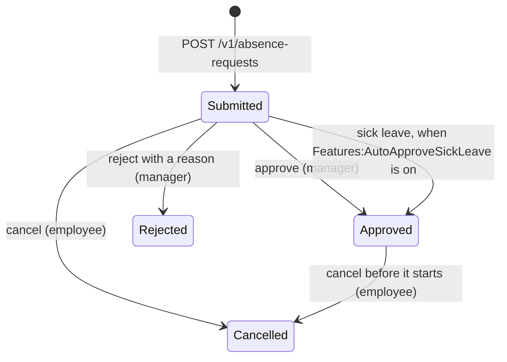

# Absence requests API

A small HR domain: employees ask for time off, their manager approves or rejects, and employees can cancel
what has not started yet. The OpenAPI document is served at `/openapi/v1.json` in every environment.



## Authentication

Every `/v1` endpoint needs a bearer JWT whose `sub` is the employee id. The `manager` role, in the `role`
claim, is needed to approve or reject. A manager only sees and decides on the requests of their direct
reports. Nobody can decide on their own request.

## Endpoints

| Method and path | Who | Success | Notes |
|-----------------|-----|---------|-------|
| `POST /v1/absence-requests` | employee | `201` with `Location` | Requires `Idempotency-Key` |
| `GET /v1/absence-requests` | anyone | `200` | Own requests, or the team's for a manager. Filters: `status`, `employeeId`; paging: `page`, `pageSize` (20 by default, 100 at most) |
| `GET /v1/absence-requests/{id}` | owner or manager | `200` | |
| `POST /v1/absence-requests/{id}/approve` | manager | `200` | |
| `POST /v1/absence-requests/{id}/reject` | manager | `200` | Body: `{ "reason": "..." }` |
| `POST /v1/absence-requests/{id}/cancel` | owner | `200` | |
| `GET /health/live`, `GET /health/ready` | anonymous | `200` | `ready` also checks the database |
| `GET /metrics` | anonymous | `200` | Prometheus format, for debugging |

Lists return `{ items, page, pageSize, totalCount, totalPages }` and a `Link` header (RFC 8288) with `first`,
`prev`, `next` and `last`.

```http
POST /v1/absence-requests
Authorization: Bearer <token>
Idempotency-Key: 7c9e6679-7425-40de-944b-e07fc1f90ae7
Content-Type: application/json

{ "type": "PaidLeave", "startDate": "2026-11-16", "endDate": "2026-11-20", "comment": "Family visit" }
```

Types: `PaidLeave`, `CompensatoryTime`, `SickLeave`, `UnpaidLeave`. Working days are counted without weekends
and French public holidays (or those of the external calendar, when the feature is on).

## Idempotency

Creating a request requires an `Idempotency-Key` header (a UUID). Sending the same key with the same body again
returns the original response, with `Idempotent-Replayed: true`, instead of creating a second request. A
retry after a timeout is therefore safe. Keys are kept for 24 hours.

## Errors

Every error is an RFC 9457 problem document with a stable `code` extension. Clients should branch on `code`,
never on `detail`.

```json
{ "type": "https://tools.ietf.org/html/rfc9110#section-15.5.10", "title": "Conflict", "status": 409,
  "detail": "The period overlaps another pending or approved absence.", "code": "absence.overlapping" }
```

| Code | Status | Meaning |
|------|--------|---------|
| `request.validation_failed` | 400 | A field is missing or malformed (`errors` lists them) |
| `absence.end_before_start` | 400 | |
| `absence.starts_in_the_past` | 400 | Only sick leave can be declared after the fact |
| `absence.too_long` | 400 | More than 90 calendar days |
| `absence.no_working_day` | 400 | The period only covers weekends or public holidays |
| `absence.comment_too_long` | 400 | |
| `absence.rejection_reason_required` | 400 | |
| `idempotency.key_missing`, `idempotency.key_invalid` | 400 | |
| `employee.unknown` | 403 | The token's subject is not an employee |
| `absence.self_approval`, `absence.not_the_manager`, `absence.not_the_owner` | 403 | |
| `absence.not_found` | 404 | Also returned for requests the caller may not see |
| `absence.overlapping` | 409 | |
| `absence.not_pending`, `absence.cannot_be_cancelled` | 409 | The request is not in a state that allows it |
| `absence.concurrent_update` | 409 | Someone changed it meanwhile: reload and retry |
| `idempotency.in_progress` | 409 | The first request with this key is still running |
| `idempotency.key_reused` | 422 | Same key, different body |
| `request.rate_limited` | 429 | See `Retry-After` |
| `request.fault_injected` | 500 | Only where fault injection is on (never in Production) |
