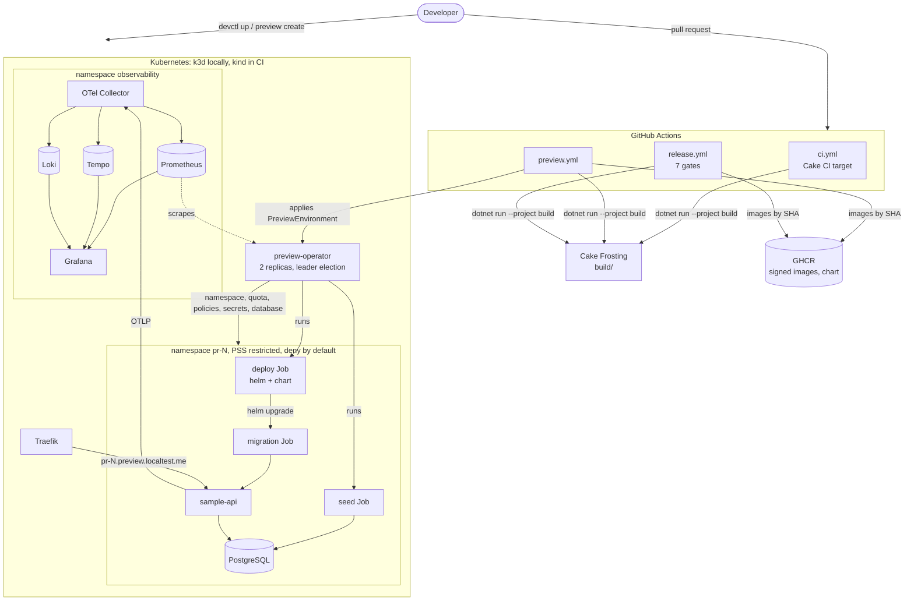
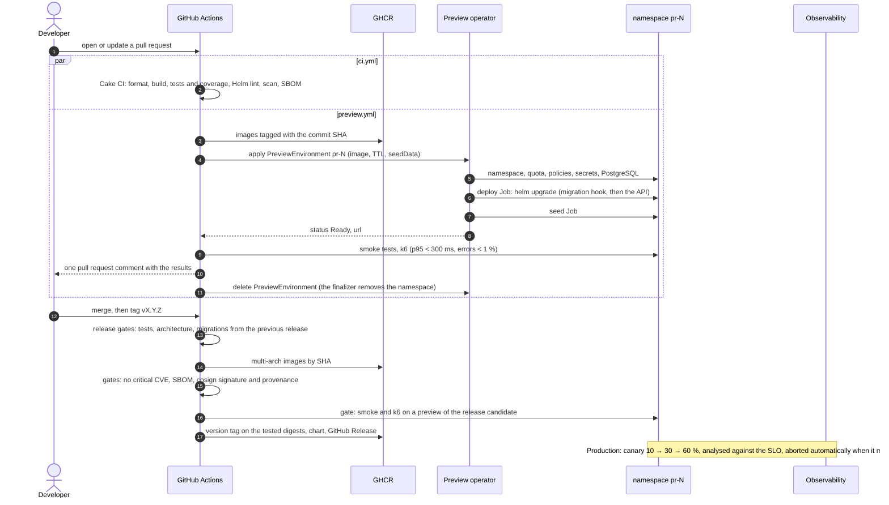
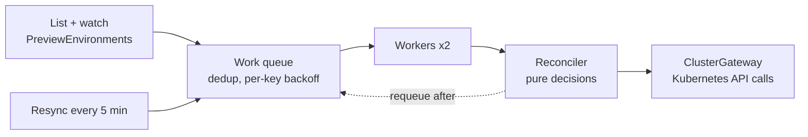

# Architecture

## Overview

| Component | Code | Role |
|-----------|------|------|
| Sample API | `src/Sample.*` | The product: absence requests, a .NET 10 Minimal API on PostgreSQL. Endpoints → application → domain ← infrastructure, enforced by `Architecture.Tests` |
| Migrator | `src/Sample.Migrator` | Applies EF Core migrations from a Helm pre-upgrade Job, never at API startup ([ADR 0003](adr/0003-migrations-in-a-pre-upgrade-job.md)) |
| Data seeder | `src/Preview.DataSeeder` | Synthetic or pseudonymised data for previews ([ADR 0009](adr/0009-pseudonymised-preview-data.md)) |
| Preview operator | `src/Preview.Operator`, `deploy/operator` | Reconciles `PreviewEnvironment` into an isolated, expiring environment ([ADR 0001](adr/0001-csharp-operator-instead-of-helm-alone.md), [ADR 0002](adr/0002-cluster-scoped-preview-resource-and-namespace-per-preview.md)) |
| CRD models | `src/Preview.Operator.Crds`, `deploy/crds` | `previewenvironments.platform.remimaigrot.dev/v1alpha1`, shared by the operator and devctl |
| devctl | `src/Devctl.Cli` | Developer CLI: local cluster, previews, status, logs, diagnosis |
| Build | `build/` | Every pipeline step as a Cake Frosting task ([ADR 0004](adr/0004-ci-logic-in-cake-frosting.md)) |
| Chart | `deploy/helm/sample-api` | How the API runs everywhere: probes, HPA, PDB, NetworkPolicy, migration hook, optional canary and backups |
| Observability | `deploy/observability` | Collector, Prometheus, Tempo, Loki, Grafana, dashboards and alert rules ([observability.md](observability.md)) |
| Backups | `deploy/backup` | Encrypted pg_dump and its daily restore test ([ADR 0010](adr/0010-encrypted-backups-and-restore-test.md)) |

## From a pull request to production

In CI, the cluster itself is ephemeral (kind, created by the job) and the preview lives as long as the job.
On a real platform, the same operator runs on a shared cluster and previews live for their TTL. Pull requests
then only apply and delete the resource.

## Inside a preview

The operator applies everything with server-side apply, in this order, and records progress in
`status.conditions`:

1. **Namespace** `pr-N` with Pod Security `restricted`, owned by the PreviewEnvironment, so that deleting
   the resource deletes it.
2. **Limits**: ResourceQuota, LimitRange.
3. **NetworkPolicies**: deny all, then DNS, ingress controller to the API, platform pods to the database,
   deployer to the Kubernetes API. The chart adds the API's own policy.
4. **Credentials**, generated once: database passwords and the JWT signing key. Connection strings derived
   from them are re-applied on every reconciliation.
5. **PostgreSQL** StatefulSet on an `emptyDir`, with an `app` role limited to data.
6. **Deploy Job**: the `sample-deployer` image (Helm and the chart of the same commit) runs
   `helm upgrade --install --rollback-on-failure`. The job name carries a hash of the values, so a new image
   or setting means a new Job.
7. **Seed Job**, when `seedData` is true.
8. **Ready**: the API's Deployment is available. The URL goes into `status.url`, and the expiry is
   scheduled.

At expiry, or when the resource is deleted, the finalizer deletes the namespace, waits for it to go, then
releases the resource.

## Reconciliation model

- The work queue follows client-go's guarantees: a key is never processed by two workers at once, a change
  during processing triggers another pass, and failures back off exponentially per key.
- The reconciler decides and the gateway executes. Reconciler tests run without a cluster, against a fake
  gateway (`tests/Preview.Operator.Tests`).
- Only the leader reconciles (a `coordination.k8s.io` Lease). The second replica takes over within about 20
  seconds.
- Every step is idempotent: a crash midway is finished by the next pass.

## Where each concern is documented

| Concern | Page |
|---------|------|
| API endpoints and error codes | [api.md](api.md) |
| Settings and their validation | [configuration.md](configuration.md) |
| Release gates | [release-qualification.md](release-qualification.md) |
| SLO, dashboards, alerts | [observability.md](observability.md) |
| Personal data, backups, retention | [data-protection.md](data-protection.md) |
| Supply chain, cluster and application security | [security.md](security.md) |
| Decisions and their trade-offs | [adr/](adr/) |
| What to do when something breaks | [runbooks/](runbooks/) |
