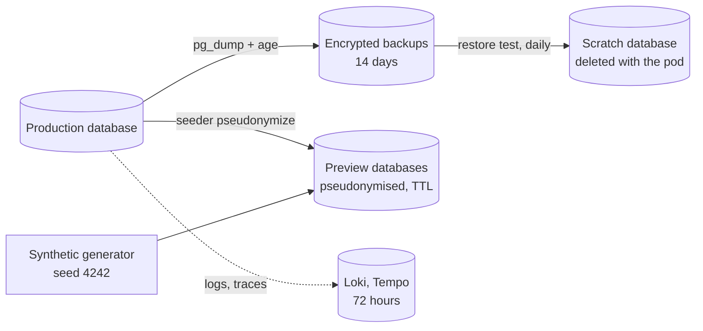

# Data protection

The sample API stores absence requests, and an absence request says a lot about a person: when they are away,
for how long, and sometimes why. A sick leave is health data in all but name. This page lists what the
platform stores, where copies go, how long each copy lives, and what proves those rules are applied.

It is written for the GDPR, but the mechanisms do not depend on it. The legal decisions (lawful basis,
retention periods, the register of processing activities) belong to whoever runs the platform for real. The
defaults below are reasonable starting points, not legal advice.

## What is personal data here

Personal fields carry `[PersonalData]` in the domain (`src/Sample.Domain`):

| Entity | Field | Why it matters |
|--------|-------|----------------|
| `Employee` | `FullName`, `Email` | Direct identifiers |
| `AbsenceRequest` | `Comment` | Free text. People write diagnoses, family events and phone numbers in it |
| `AbsenceRequest` | `RejectionReason` | Free text written by the manager about the employee |

The other fields (ids, dates, type, status) are personal data too once they are linked to an employee. They
are not tagged because they cannot be removed without losing the request itself. They are covered by
pseudonymisation (ids, dates) and by the retention of whole requests.

The tag has one job: `PersonalDataTests` in `tests/Preview.DataSeeder.Tests` fails when a tagged property is
not handled by the pseudonymiser. Adding a personal field without deciding what happens to it outside
production breaks the build.

## Where the data goes



| Copy | Content | Lifetime | Who can read it |
|------|---------|----------|-----------------|
| Production database | Real data | Retention policy below | The API (DML only), migrations (DDL) |
| Backups | Real data, encrypted with age | 14 days (`backup.keepDays`) | Holders of an age private key |
| Restore test database | Real data, decrypted | The few minutes the Job runs | Nobody: localhost only, no Service, no ingress |
| Preview databases | Synthetic, or pseudonymised | The preview TTL (72 h at most) | Anyone with access to the preview |
| Logs and traces | No personal fields by design (see below) | 72 hours | Platform team |

## Previews never hold real data

A preview gets one of two datasets, set by `seedData` on the `PreviewEnvironment`:

- **Synthetic** (the default). Bogus generates 30 employees and their requests from a fixed seed, so every
  preview has the same rows and a test can rely on them.
- **Pseudonymised copy**, for bugs that only show up on real data shapes. `Preview.DataSeeder pseudonymize`
  reads a source database and writes:
  - ids derived with HMAC-SHA256 and a secret salt. The same person gets the same id in every table, so
    joins still work. Without the salt, the original id cannot be recovered by brute force.
  - fake names, and emails under `example.invalid`. That domain cannot receive mail (RFC 2606).
  - dates shifted by -45 to +45 days, the same shift for every row of one person. Durations and overlaps stay
    true, while "who was away on 12 March" can no longer be answered.
  - free text replaced by generated sentences.

Pseudonymised data is still personal data under the GDPR (recital 26): with the salt, the mapping could be
rebuilt. The salt therefore lives in a secret that previews cannot read. The copy is also only made from
a database the operator of the platform already has access to.

## Retention

`DataRetentionService` runs inside the API every 6 hours. It applies `DataRetentionPurger`, two set-based
statements:

| Rule | Default | Setting |
|------|---------|---------|
| Erase `Comment` and `RejectionReason` once the decision is older than | 180 days | `DataRetention:FreeTextRetention` |
| Delete the request once the absence ended longer ago than | 5 years | `DataRetention:RequestRetention` |

Free text goes first because it is the riskiest field and the least useful once a request is decided.
Pending requests keep their comment, since the manager still has to read it. The request itself is kept for
5 years, a common period for payroll and labour law records. Check it against the law that applies to you.

Both statements are idempotent. Running on every replica at once is harmless, and an interrupted run is
completed by the next one. Startup fails when the free-text retention is not shorter than the request
retention. Setting `DataRetention:Enabled=false` logs a warning on every start.

Tested in `DataRetentionTests` against a real PostgreSQL: old free text is erased, recent and pending
comments are kept, old requests are deleted, and a second run changes nothing.

### Erased data in backups

A comment erased today still exists in the backups taken before today. It disappears when the last of them
expires, 14 days later. Restoring a backup brings it back. Restoring is an exceptional operation, and the
next retention run, at most 6 hours after the API starts, erases it again. The
[restore runbook](runbooks/restore-from-backup.md) says to check that the run happened.

## Backups

`backup.enabled` in the chart creates two CronJobs. The image is `deploy/backup/Dockerfile`: the PostgreSQL 17
client, `age` and two scripts.

**Backup** (`backup.sh`, daily at 02:15 UTC):

1. Opens a repeatable-read transaction and exports its snapshot.
2. `pg_dump --snapshot` of that snapshot, piped straight into `age --encrypt`. The plaintext dump never
   touches a disk.
3. Counts the rows of the same snapshot and writes them, with the checksum of the encrypted file and the
   latest migration, to a manifest next to the dump.
4. Deletes backups older than `keepDays`.

**Encryption.** age with X25519 public keys. The backup job only holds public keys, which are not secrets:
the backup pod can write backups but cannot read them. List at least two recipients:

- the restore-test key, whose private half is a Kubernetes Secret mounted only in the restore-test pod;
- a recovery key, generated offline and kept by someone outside the platform team (a printed copy in a safe,
  a hardware token). It is what recovers data if the cluster and its Secrets are lost.

```sh
age-keygen -o recovery.key      # keep offline, never in the cluster
age-keygen -y recovery.key      # public key, goes into backup.recipients
```

**Where backups live.** Here, a PersistentVolumeClaim with `helm.sh/resource-policy: keep`, so uninstalling
the release does not delete it. A real setup writes to object storage in another account, with object lock,
so that a compromised cluster cannot delete its own backups. The scripts only need a directory, and the
change is in the chart, not in the scripts.

## Restore test

A backup that has never been restored is a hope. `restore-check.sh` runs every day at 03:45 UTC, in a pod
with two containers:

- a scratch PostgreSQL, started as a native sidecar and reachable on localhost only. Its data is an
  `emptyDir` deleted with the pod;
- the check, which:
  1. takes the latest manifest and fails if it is older than 26 hours (backups have stopped);
  2. verifies the checksum (the file was altered or truncated);
  3. decrypts and restores with `pg_restore --exit-on-error`;
  4. compares row counts and the latest migration with the manifest;
  5. checks integrity: no request without its employee, no period ending before it starts, at least one
     employee.

The Job has `backoffLimit: 0`. A failed restore test is a finding, and a retry that happens to pass would
hide it. Three alerts watch the CronJobs through kube-state-metrics (`deploy/observability/rules/backup.rules.yaml`):

| Alert | Fires when | Severity |
|-------|-----------|----------|
| `RestoreTestFailed` | a restore-test Job failed | page |
| `BackupTooOld` | no successful backup for 26 hours | page |
| `RestoreTestNotRunning` | no passing restore test for 50 hours | ticket |

`deploy/backup/test.sh` runs the whole chain with Docker on every CI run (Cake task `Backup-Test`). It
migrates and seeds a database with the real images, backs it up, and checks that the encrypted file
contains no plaintext. It then checks that the restore test passes, and that it fails with the wrong key and
with an altered file.

## Logs, traces and metrics

Telemetry should never need personal data, so none is put there:

- log messages use ids, never names, emails or comments. `LoggerMessage` templates make it visible in review
  which values go into a log line;
- traces carry the route and the path, which holds a request id, never a request body. The Npgsql
  instrumentation records the SQL text with its placeholders (`WHERE id = @p2`), not the parameter values;
- metrics have no per-user label. That would also make cardinality explode.

The 72-hour retention of Loki and Tempo limits what a mistake would expose.

## Rights of the people concerned

| Right | How |
|-------|-----|
| Access (art. 15) | `GET /v1/absence-requests` as the employee returns all of their requests |
| Rectification (art. 16) | A wrong request is cancelled and submitted again; names and emails come from the identity provider |
| Erasure (art. 17) | Not automated. An operator pseudonymises the employee (`Employee.Pseudonymise`, as the seeder does) and erases their free text; backups age out within 14 days |
| Restriction, objection | Handled by the HR process, outside this API |

There is no erasure endpoint: who may erase whom, and when legal retention prevails, is a decision for HR and
the data protection officer. An API would only make that decision faster to get wrong.

## Known limits

- Backups go to a volume in the same cluster. See "Where backups live" above.
- `pg_dump` is a logical backup: restoring it means losing what happened since the last run, up to 24 hours.
  A database that cannot lose a day needs continuous WAL archiving (pgBackRest, or a managed service's
  point-in-time recovery). The restore test applies just as well to those.
- Retention runs inside the API. When the API is down for days, retention waits. A CronJob would decouple it,
  at the cost of one more workload per environment.
- Previews are reachable by anyone who can reach the preview domain. They hold no real data, which is why that
  is acceptable. It also means nobody should paste real data into one.
