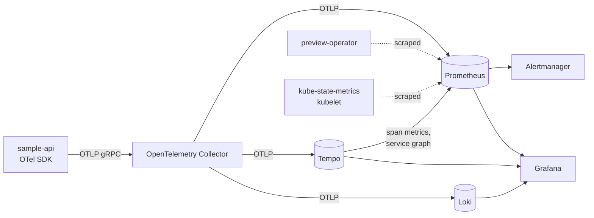

# Observability

Everything lives in `deploy/observability`, a Helm chart that bundles the upstream charts with this platform's
configuration, dashboards and alert rules. `devctl up` installs it in the `observability` namespace. Skip it with
`--skip-observability` when memory is short: the stack takes about 1.5 GB.



| Signal | Path | Retention (local) |
|--------|------|-------------------|
| Metrics | SDK → collector → Prometheus OTLP receiver | 7 days |
| Traces | SDK → collector → Tempo | 72 hours |
| Logs | SDK → collector → Loki OTLP endpoint | 72 hours |

The API exports nothing unless `OTEL_EXPORTER_OTLP_ENDPOINT` is set. The operator sets it for every preview,
so tests and a plain `dotnet run` stay quiet. Its JSON logs on stdout stay available through `kubectl logs`
either way.

The operator is scraped rather than pushing. It runs in a namespace whose NetworkPolicy opens `/metrics` to
`observability` only, and a scrape also tells Prometheus when a replica is down (`up == 0`).

## Labels that matter

Prometheus promotes these OTel resource attributes to labels:

| Label | From | Used for |
|-------|------|----------|
| `job` | `service.name` | `sample-api` in every query |
| `k8s_namespace_name` | set by the chart | one series per environment (`local`, `pr-42`) |
| `preview_pull_request` | set by the operator | excluding previews from paging alerts |
| `service_version` | assembly version | the "new version" annotation on the API dashboard |
| `instance` | pod name | matches what `kubectl get pods` shows |

Loki indexes the same attributes. A preview's logs are `{k8s_namespace_name="pr-42"}`, without scanning the
other environments.

## Going from one signal to another

- **Metric → trace.** The latency panel shows exemplars, recorded for requests that were part of a sampled
  trace. Clicking one opens that trace in Tempo.
- **Trace → logs.** From a span, "Logs for this span" queries Loki on `trace_id`. OTLP log records carry it as
  structured metadata.
- **Log → trace.** In a log line's details, the `TraceID` field links to Tempo.
- **Trace → metrics.** From a span, the request rate of the same service.
- **Service graph.** Tempo derives `sample-api → postgresql` from the spans. It is in Explore → Tempo →
  Service graph.

## Dashboards

Dashboards are JSON files in `deploy/observability/dashboards`. Each one becomes a ConfigMap that the Grafana
sidecar loads into the *Platform* folder. Grafana provisions them read-only. To change one, edit it in
Grafana, export it as JSON ("Export for sharing externally" off), replace the file, and commit.
`Observability-Check` rejects a dashboard that uses a datasource uid other than `prometheus`, `loki` or
`tempo`.

| Dashboard | Answers |
|-----------|---------|
| Sample API: RED and SLO | Is the API meeting its SLO in this environment? Rate, errors and latency per route, business counters, database latency, recent errors and slow traces. |
| Preview operator | Is the operator healthy? Replicas, leader, reconciliation rate, errors and duration, queue depth. |
| Preview environments | How many previews exist, in which phase, which ones get traffic or fail, and what they cost in CPU and memory. |

Grafana runs at `http://grafana.preview.localtest.me:8080`. Anonymous visitors get read-only access. The admin
password is generated at install time:

```sh
kubectl -n observability get secret grafana -o jsonpath='{.data.admin-password}' | base64 -d
```

## SLO

**99.5 % of requests to the API, over 30 days, are answered without a 5xx and in 300 ms or less.**

- One SLI covers availability and latency, because a request that takes 2 s is a failure from the user's
  side. 4xx answers are the client's problem and count as good.
- 300 ms is a bucket boundary of the request duration histogram (`ObservabilityExtensions.LatencyBuckets`).
  The SLI is therefore exact: `bucket{le="0.3"}` minus 5xx, divided by the request count. A threshold that
  falls between two buckets could only be estimated.
- Health probes and `/metrics` are excluded. They are not user traffic, and their volume would hide real
  errors.

### Error budget

0.5 % of 30 days is 3 h 36 min of total outage, or 0.5 % of requests. With 10 requests per second that is
about 130,000 failed or slow requests a month. When the budget is spent, the team stops shipping features
and works on reliability until the 30-day window recovers. When the budget is mostly intact, a risky
migration or a canary at 50 % is affordable.

### Alerts

Burn-rate alerts follow the multiwindow, multi-burn-rate method of the Google SRE workbook. A burn rate of 1
spends the budget in exactly 30 days.

| Alert | Burn rate | Windows | Budget spent when it fires | Severity |
|-------|-----------|---------|----------------------------|----------|
| `SampleApiErrorBudgetBurnFast` | 14.4 | 1 h and 5 min | 2 % | page |
| `SampleApiErrorBudgetBurnMedium` | 6 | 6 h and 30 min | 5 % | page |
| `SampleApiErrorBudgetBurnSlow` | 3 or 1 | 1 d and 2 h, or 3 d and 6 h | 10 % | ticket |

The long window proves the budget is really burning. The short window proves it still is, so the alert
resolves minutes after a fix instead of an hour later.

Pull request previews have no SLO. They run test traffic, sometimes a broken build on purpose, and they are
gone within hours. Paging someone for them would teach the team to ignore pages. The burn-rate alerts
therefore skip series with a non-zero `preview_pull_request`. The local environment (pull request 0) keeps
its SLO, so the alerts can be tried locally.

Two symptom alerts cover every environment, previews included, and open tickets: `SampleApiHighErrorRate`
(more than 5 % of 5xx) and `SampleApiHighLatency` (p95 above 300 ms). Both ignore environments under 0.1
request per second, so that a single failing request on an idle preview stays quiet.

The operator has its own alerts: no reachable replica, no leader, a lasting reconciliation error ratio, a
preview stuck in `Pending` or `Provisioning` for 20 minutes, a `Failed` preview, and a growing queue.

Each alert links to a runbook in [docs/runbooks](runbooks/).

### Testing the rules

Rules are plain Prometheus rule files, with unit tests next to them:

```sh
dotnet run --project build -- --target Observability-Check
```

The task runs `promtool check rules` and `promtool test rules` from the Prometheus image, checks the
dashboards, and renders the chart. The tests replay synthetic series, for example 10 % of 5xx for 90 minutes.
They assert which alerts fire, with which labels and messages, and that a pull request preview with the same
errors pages nobody.

## Trying it

```sh
devctl up
k6 run -e BASE_URL=http://local.preview.localtest.me:8080 -e SIGNING_KEY=... load/preview-smoke.js
```

Then open the *Sample API* dashboard on the `local` environment. The signing key is in the `sample-api-secrets`
Secret of the `local` namespace, as the smoke tests read it.

## Limits

- Everything runs as one replica on local disks. A shared cluster needs object storage for Tempo and Loki,
  two Prometheus replicas (or a remote store), and Alertmanager receivers. Those are configuration changes to
  `values.yaml`, not changes to the pipeline.
- Alertmanager has no receiver configured. Alerts are visible in Grafana and Alertmanager but notify nobody,
  since that needs credentials this repository must not hold.
- The 30-day error budget panel can only cover what Prometheus retains, which is 7 days locally.
- Traces are not sampled: every request is kept. That is fine for previews. Production would sample at the
  collector, with tail sampling to keep errors and slow requests.
